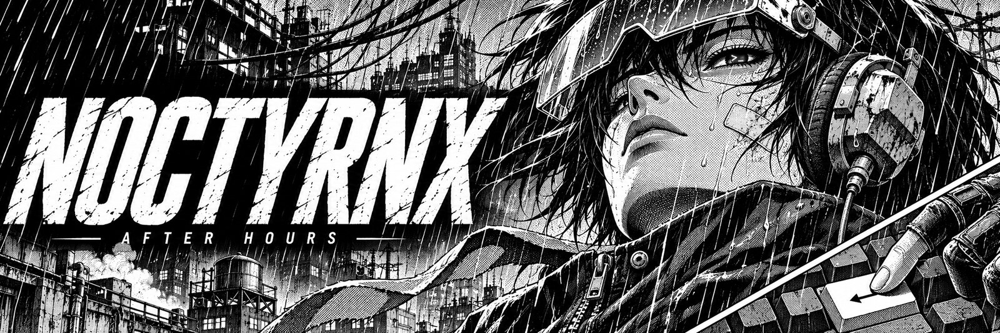

  

<h1 align="center">Noctyrnx</h1>

<strong>Python · автоматизация · Telegram-боты · AI</strong>

Собираю инструменты для задач, которые слишком часто приходится делать вручную.

  <a href="https://t.me/GyaruDev">Telegram</a> &nbsp;·&nbsp;
  <a href="https://vk.com/h4ckm3">VK</a> &nbsp;·&nbsp;
  <a href="https://github.com/H4ckMM3?tab=overview">Активность GitHub</a>

<h2>Три задачи после полуночи</h2>

<table>
  <tr>
    <td width="33%"></td>
    <td width="33%"></td>
    <td width="33%"></td>
  </tr>
  <tr>
    <td><strong>SEO-Autotester</strong> Проверить сайт и подготовить метатеги. Python · Flet · LLM</td>
    <td><strong><a href="https://github.com/H4ckMM3/Snippet-Bot">Snippet Bot ↗</a></strong> Найти нужный кусок кода прямо в Telegram. Python · aiogram</td>
    <td><strong><a href="https://github.com/H4ckMM3/FinanseApp">FinanseApp ↗</a></strong> Посмотреть, куда ушли деньги. Python · Flet</td>
  </tr>
</table>

  <a href="https://github.com/H4ckMM3/FTP-Backup"><strong>FTP-Backup</strong></a> · резервные копии на Python 
  <a href="https://github.com/H4ckMM3/chat-local"><strong>Chat Local</strong></a> · локальный чат на сокетах с Node.js 
  <a href="https://github.com/H4ckMM3/Snake-Game"><strong>Snake Game</strong></a> · змейка на JavaScript и Canvas

<h2>В работе</h2>

Собираю десктопные приложения на Flet, пишу ботов на aiogram и подключаю LLM к SEO-задачам. Сейчас углубляюсь в FastAPI и Django, чтобы превращать локальные инструменты в сервисы, которыми могут пользоваться другие.

<h2>Активность на GitHub</h2>

  
   
  

  <picture>
    <source media="(prefers-color-scheme: dark)" srcset="https://raw.githubusercontent.com/H4ckMM3/h4ckmm3/snake-output/snake-dark.svg">
    
  </picture>

つづく / Продолжение следует

