  <picture>
    <source media="(prefers-reduced-motion: reduce)" srcset="assets/marin-signature.jpg">
    
  </picture>

<h1 align="center">marin</h1>

  

  <a href="https://t.me/GyaruDev">Telegram</a> &nbsp;·&nbsp;
  <a href="https://vk.com/h4ckm3">VK</a>

<h2>Активность на GitHub</h2>

  <picture>
    <source media="(prefers-color-scheme: dark)" srcset="https://raw.githubusercontent.com/H4ckMM3/h4ckmm3/snake-output/snake-dark.svg?v=pink">
    
  </picture>

  
  

  

