  <picture>
    <source media="(prefers-reduced-motion: reduce)" srcset="assets/marin-signature.jpg">
    
  </picture>

  

  
  
  

  

  

  

<h2>Инженерная практика</h2>

  

  

  

  

  

