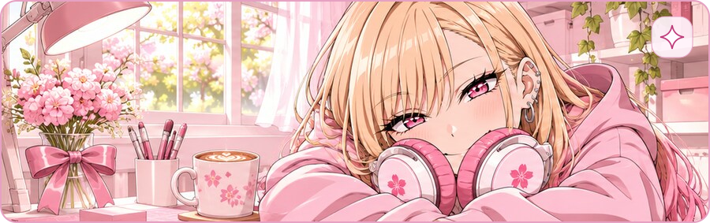
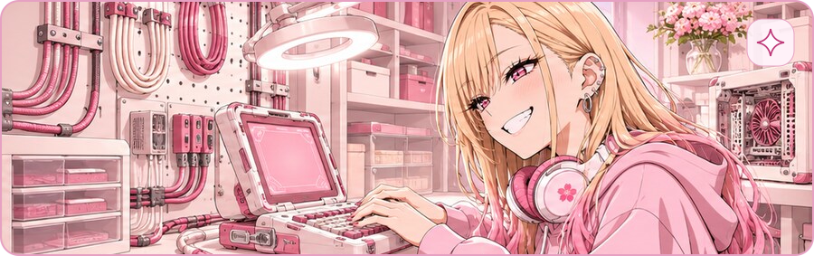
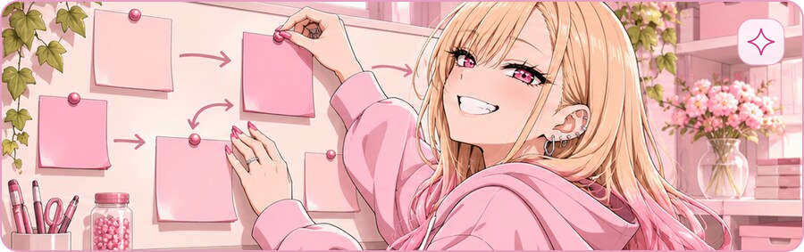
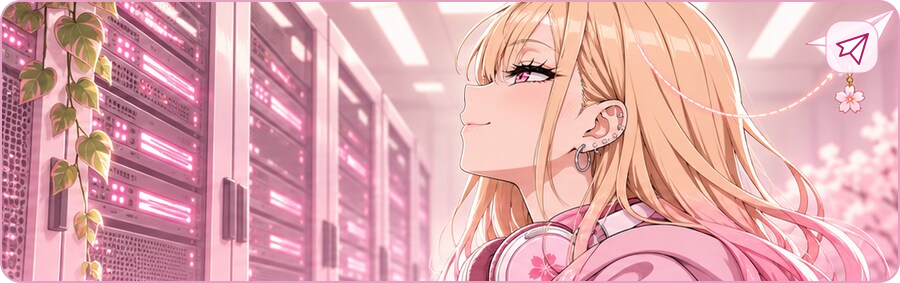
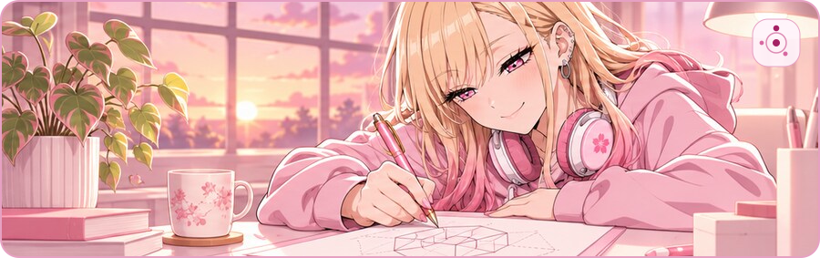

  <picture>
    <source media="(prefers-reduced-motion: reduce)" srcset="assets/marin-signature.jpg">
    
  </picture>

  
   
  

  
  
  

  
   
  

  
   
  

  
   
  

<h2>Инженерная практика</h2>

<h3>Проверка изменений</h3>

Прогнать проверки и разобрать ошибки до слияния.

  

<h3>Путь релиза</h3>

Собрать версию, запустить проверки и убедиться, что всё работает после выкладки.

  

<h3>Диагностика</h3>

Воспроизвести сбой по логам и метрикам, найти причину и проверить исправление.

  

<h3>Инженерные принципы</h3>

Воспроизводимый запуск, понятные ошибки и минимум ручных шагов.

  

<h2 align="center">Марин Китагава</h2>

  
  
  

